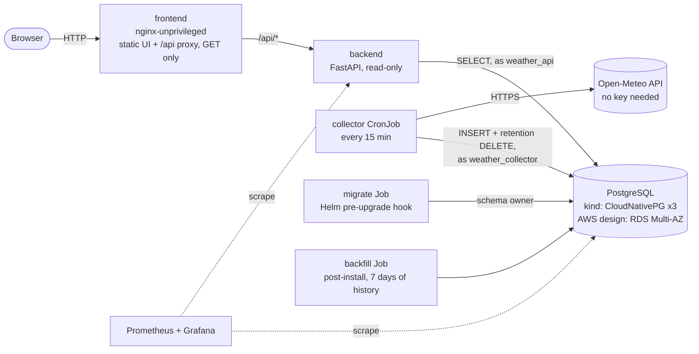
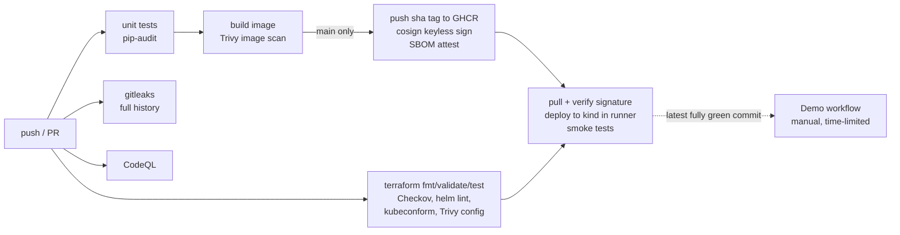

# Weather App

Shows the current weather for 6 world cities and keeps a history of past readings. It has a frontend, a backend and a database, and runs on Kubernetes. Terraform builds it and GitHub Actions tests it.

## What is real and what is a design

| Part | Status | Where it is proven |
|---|---|---|
| App, Helm chart, Kubernetes security, monitoring | **Deployed** on kind (Kubernetes in Docker): on a laptop, and again on every CI run | CI job "Deploy to ephemeral kind + smoke tests" (14 checks) |
| Local platform (kind, CloudNativePG, Prometheus/Grafana) | **Deployed** by Terraform in [`infra/local`](infra/local) | same CI job, plus `make local-up` |
| AWS (VPC, EKS, RDS, ECR, WAF, OIDC, Pod Identity) | **Designed only.** Never applied, never tested against a real AWS account | `terraform validate`, `terraform test` with a mocked provider (5 tests), Checkov (0 failed; each remaining exception has a written reason, and the IAM ones are scoped to one module) |

There was no AWS account for this task and no budget, so nothing here creates paid resources. The same Helm chart is meant for both targets; only the values file changes ([`values-local.yaml`](deploy/helm/weather/values-local.yaml) vs [`values-aws.yaml`](deploy/helm/weather/values-aws.yaml)).

## Architecture



- Only the frontend is reachable from outside. The backend, `/metrics` and the database are internal.
- Every namespace starts with a **default-deny NetworkPolicy**; each allowed connection is listed explicitly.
- Pods run under Pod Security **restricted**: non-root, read-only filesystem, all capabilities dropped.
- Each workload has its own DB user with only the rights it needs.
- Details and reasons: [docs/decisions.md](docs/decisions.md). Guidance for the team: [docs/JUNIORS.md](docs/JUNIORS.md).

## Run it locally

Needs Docker, kind, kubectl, Helm, Terraform ≥ 1.10 and Python 3.13.

```bash
make test          # backend unit tests + Terraform mocked tests
make local-up      # kind cluster + CloudNativePG + monitoring + app (takes ~10 min the first time)
```

- UI: http://127.0.0.1:8088. History is already filled: the backfill job loads the last 7 days on install.
- Kubeconfig: `~/.kube/kind-weather`, outside the repo on purpose because it holds the cluster admin key.
- Grafana:
  ```bash
  KUBECONFIG=~/.kube/kind-weather kubectl -n monitoring port-forward svc/kube-prometheus-stack-grafana 3000:80
  ```
  Then open http://127.0.0.1:3000. User `admin`; get the password with:
  ```bash
  terraform -chdir=infra/local output -raw grafana_password
  ```
- Collect now instead of waiting 15 minutes: `make local-collect`
- Delete everything: `make local-down`

The fastest check, without Kubernetes, is `docker compose up` (app + Postgres, password from a gitignored `.env`).

## CI/CD



- **No stored credentials:** GHCR uses the job's short-lived `GITHUB_TOKEN`. Signing is keyless (GitHub OIDC → Sigstore). The AWS design uses OIDC, so there are no access keys.
- **Promotion:** images are tagged only with `sha-<commit>`, and no moving `latest` tag exists. The demo deploys the newest commit whose **whole** CI run passed.
- **Newest commit wins:** a new push cancels the older CI run on the same branch. This is safe because the deploy target is a throwaway cluster. A future AWS deploy job must use its own group that never cancels.
- **Pinned supply chain:** all actions are pinned by commit SHA and all base images by digest. Dependabot updates them.

### Demo workflow (public URLs, time-limited)
Actions → "Demo (temporary public URL)" → Run, choosing 1–120 minutes. It deploys to kind inside a runner and opens two Cloudflare quick tunnels, one for the app and one for read-only Grafana. **The URLs are printed in the public run log, so anyone who can see this repo's Actions can open them while the demo runs.** When the job ends, everything is gone. Risks and options: [docs/decisions.md D12](docs/decisions.md#d12-public-demo-exposure).

## Repo map

| Path | What |
|---|---|
| `app/backend` | FastAPI API, collector, backfill, migrations, unit tests |
| `app/frontend` | static UI + nginx config (CSP and other security headers) |
| `deploy/helm/weather` | the app chart (deployments, CronJob, hooks, NetworkPolicies, monitoring, 4 dashboards) |
| `infra/local` | Terraform: kind + CloudNativePG + monitoring + app |
| `infra/terraform` | Terraform: AWS design (not applied) + mocked tests |
| `infra/bootstrap` | Terraform: state bucket (AWS design) |
| `.github/` | CI, demo workflow, composite actions, Dependabot |
| `scripts/smoke-test.sh` | functional + security-control checks against a running cluster |
| `docs/` | decisions, junior guide |

## Known limits
- AWS has never been applied. Quotas, regional versions and module behaviour are only proven by a real `plan`/`apply`.
- The kind "zones" are node labels on one machine. They test the scheduling rules (spread, anti-affinity), not real availability-zone failure.
- The DB failover test was run once by hand on kind: the primary was killed and 45 of 45 API calls succeeded. That is a measurement, not a zero-downtime guarantee.
- Image signatures are verified in CI before deploy, but the cluster itself does not reject unsigned images (see D13).
- Open-Meteo's free tier is for non-commercial use.
